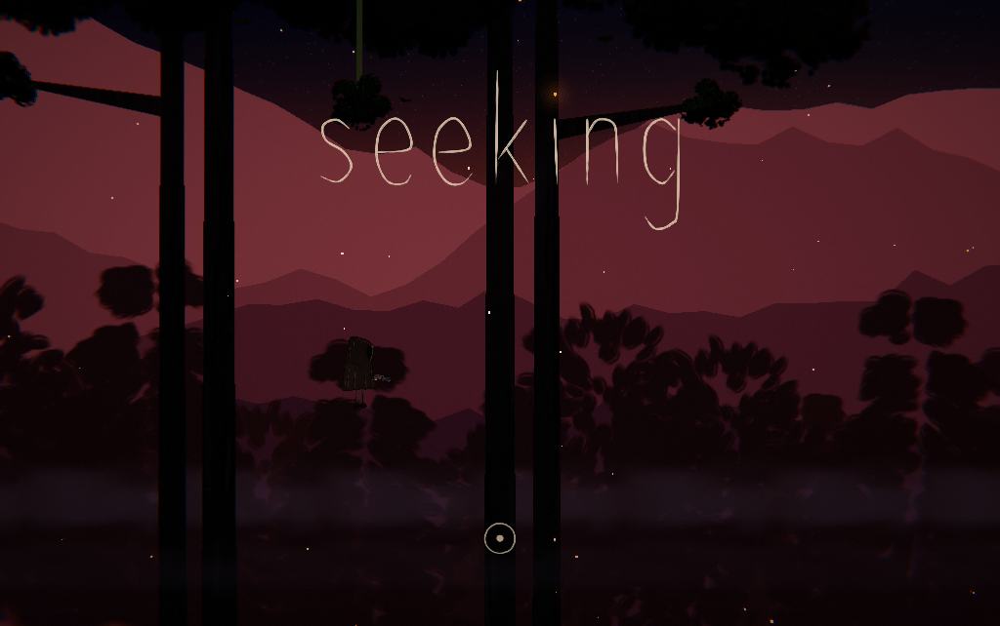
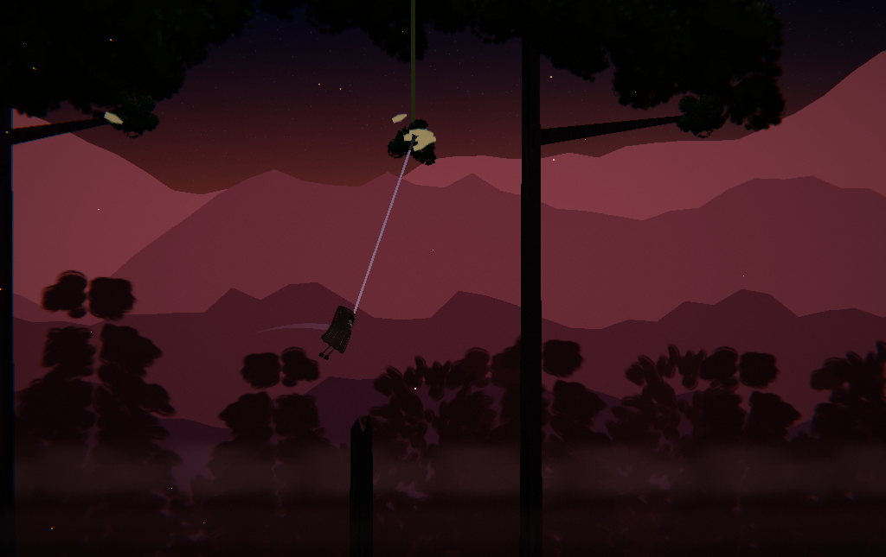

# Seeking



A wordless, hand-painted swinging game. Hold to cast the hook; let go to fly.

**Play now: [eouzoe.itch.io/seeking](https://eouzoe.itch.io/seeking)** (Windows and macOS builds).



## Build from source

```sh
git clone https://github.com/eouzoe/seeking.git
cd seeking
./build.sh        # macOS app: build/Seeking.app
./build.sh win    # Windows: build/Seeking.exe
```

The script runs on macOS or x86_64 Linux and needs nothing installed.

| Build | Runs on |
| --- | --- |
| macOS | macOS 13+ on Apple silicon, macOS 12+ on Intel |
| Windows | Windows 10+, x86_64, graphics with Direct3D 12 or Vulkan 1.0 |

## Controls

Hold Space or the left mouse button. Esc pauses; twice returns to the title. F11 or Control–Command–F toggles full screen.

[Credits](CREDITS.md)
